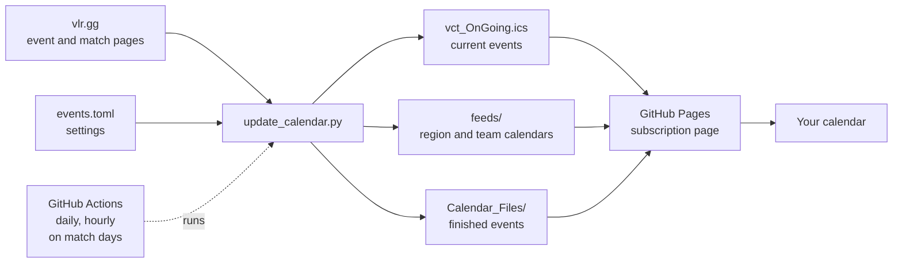
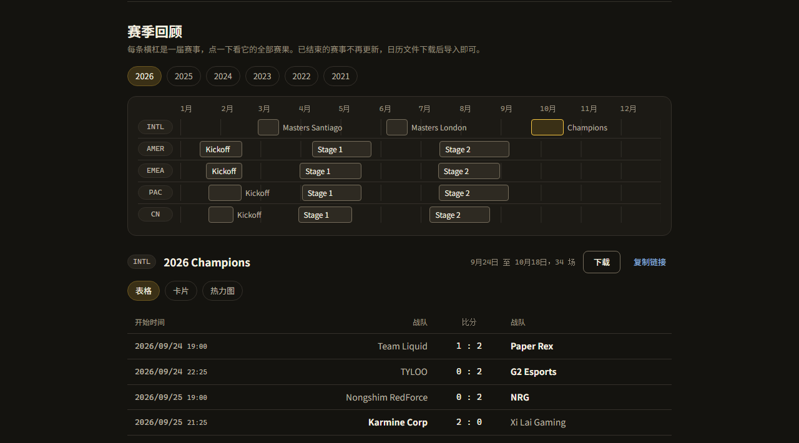

# VCT Matches to iCal

[English](README.md) | [简体中文](README.zh.md)

[](https://github.com/Adamchen566/VCT-matches-to-iCal/actions/workflows/update_OnGoing.yml)
[](https://github.com/Adamchen566/VCT-matches-to-iCal/actions/workflows/tests.yml)
[](requirements.txt)
[](LICENSE)

Subscribe to VCT (Valorant Champions Tour) match times and scores in the calendar on your phone and computer. The data comes from [vlr.gg](https://www.vlr.gg) and GitHub Actions keeps it up to date, so there is nothing to run yourself.

**[Open the subscription page](https://adamchen566.github.io/VCT-matches-to-iCal/)** (in Chinese)

[](https://adamchen566.github.io/VCT-matches-to-iCal/)

## How to use it

| You want | Do this |
|---|---|
| Every event | Press the amber subscribe button on the [subscription page](https://adamchen566.github.io/VCT-matches-to-iCal/) |
| One region | The region list on the page: AMER, PAC, EMEA, CN, and INTL for international events |
| One team | The team list on the page, which has a search box |
| Past results | The season review on the page, or the calendar files in [`Calendar_Files/`](Calendar_Files) |

Choose "subscribe", not "import". An imported calendar never updates.

| Device | How to subscribe |
|---|---|
| iPhone, iPad, Mac | Press a subscribe button on the page, or paste the link into Calendar's "Add Subscription Calendar" |
| Google Calendar | On the desktop site, press the plus next to "Other calendars", choose "From URL" and paste the link |
| Xiaomi and other Android phones | The system calendar usually cannot subscribe to a URL. Install a sync app such as [ICSx⁵](https://icsx5.bitfire.at/), add the link and turn on automatic sync |

The links also work on their own:

- Every event: `https://adamchen566.github.io/VCT-matches-to-iCal/vct_OnGoing.ics`
- A region: `https://adamchen566.github.io/VCT-matches-to-iCal/feeds/region/AMER.ics` (swap `AMER` for `PAC`, `EMEA`, `CN` or `INTL`)
- A team: `https://adamchen566.github.io/VCT-matches-to-iCal/feeds/team/paper-rex.ics` (team name in lower case with hyphens; the page lists them all)

## What it looks like in a calendar


The picture is an illustration drawn from the real event titles. The exact look depends on your calendar app.

- Before a match the title reads `[CN] A vs B (Bo3)`. Once there is a score it becomes `[CN] A 2:1 B`.
- Every match keeps a fixed UID, so reschedules and score updates never create duplicates.
- To keep scores out of titles (no spoilers), set `score_in_title = false` in [`events.toml`](events.toml).

## How it works



| Part | What it does |
|---|---|
| Discovery | Each run reads vlr.gg's event list and tracks ongoing and upcoming tier-1 VCT events: Kickoff, Stage 1 and Stage 2 in the four regions, plus Masters and Champions |
| Schedule | Once a day, and every hour while a match is about to start or in progress, so scores and reschedules arrive within the hour |
| Archiving | Seven days after an event's last match it leaves the live calendar and is archived to `Calendar_Files/`, `TEXT_Files/` and `data/archive/` |
| Guarding against bad data | A scrape with fewer matches than the last published one is refused. Each run first parses a finished event as a canary, to tell "no schedule yet" apart from "the page layout changed" |
| Alerts | A failed scheduled run opens an issue with the log attached, and the next successful run closes it |

## Season review

The subscription page draws each year's events on a timeline. Pick one to see all its results as a table, cards or a heatmap.

[](https://adamchen566.github.io/VCT-matches-to-iCal/#season)

## Desktop GUI

The repository also holds an offline desktop viewer that reads the same calendar files and offers the same three views.

| Table View | Card View | Heatmap View |
|------------|-----------|--------------|
|  |  |  |

```bash
python -m pip install -r requirements-gui.txt
python GUI.py
```

The GUI only reads `vct_OnGoing.ics` and `Calendar_Files/` from the repository and never touches the network. Its copy button copies the subscription link of the event on screen.

## Match statistics

Beyond the schedule, the repository keeps detailed statistics parsed from vlr.gg match pages in [`data/stats/`](data/stats), ready for analysis.

| To study | Use |
|---|---|
| Maps: play counts, picks and bans, side balance | `maps.csv`, `vetoes.csv`, `rounds.csv` |
| Compositions and agent picks | The composition columns in `maps.csv`, the agent column in `player_stats.csv` |
| Player performance | `player_stats.csv`: rating, ACS, KDA, KAST, ADR, headshot rate and first kills, each split by side, plus multi-kills and clutches |
| Economy | `rounds.csv`: each team's buy type, loadout value and bank for every round |
| Ready-made summaries | Per-year map, agent, composition, player and team tables in `summary/` |

Every column is described in [`data/stats/README.md`](data/stats/README.md) (in Chinese). `vlr_stats.py` downloads and parses the pages, and `analyze_stats.py` builds the summaries.

## Run it yourself

Python 3.11 or newer, on Windows, macOS or Linux.

```bash
git clone https://github.com/Adamchen566/VCT-matches-to-iCal
cd VCT-matches-to-iCal
python -m pip install -r requirements.txt
python update_calendar.py
python update_calendar.py --check
```

| Output | Contents |
|---|---|
| `vct_OnGoing.ics` | The live subscription calendar |
| `vct_OnGoing.txt` | A readable schedule in Sydney time |
| `data/matches.json` | The match cache that keeps updates stable |
| `feeds/` | One calendar per region and per team, plus the index and results the page reads |

| Task | How |
|---|---|
| Add a qualifier or third-party event | Discovery only recognises tier-1 events; add others in [`events.toml`](events.toml) with `[[events]]` |
| Change retention or the display timezone | Also in `events.toml` |
| Archive an event that already ended | `python update_calendar.py --archive 2766/valorant-champions-2026` |
| VLR really removed a match | `python update_calendar.py --allow-shrink` |
| Run the tests | `python -m unittest discover -s tests` |

The link preview image and the calendar illustration are rendered from [`images/social-card.html`](images/social-card.html). After editing it, take a new screenshot with a headless browser:

```bash
msedge --headless --hide-scrollbars --window-size=1200,630 --screenshot=images/social-card.png images/social-card.html
```

## License and feedback

Released under the MIT License, see [LICENSE](LICENSE). Not affiliated with Riot Games or vlr.gg.

Please report problems and ideas in [Issues](https://github.com/Adamchen566/VCT-matches-to-iCal/issues). Forks and pull requests are welcome.
