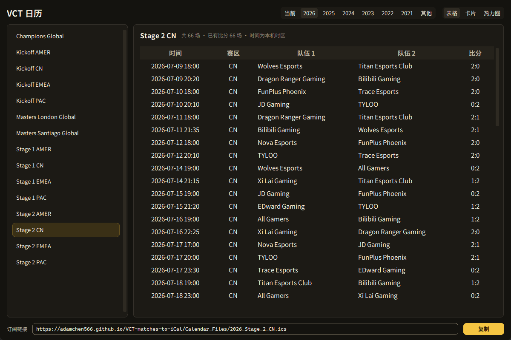

# VLR.gg Valorant Match Scraper

[English](README.md) | [简体中文](README.zh.md)

---

## 📖 Project Overview

This project is a Python-based crawler and GUI viewer for **Valorant** match data from [VLR.gg](https://www.vlr.gg). It supports calendar export (`.ics`), interactive GUI views (table, card, heatmap), and match tracking across regions and years.

The subscription calendar **auto-discovers** ongoing and upcoming tier-1 VCT events on vlr.gg, so nothing needs editing between seasons. It covers Kickoff / Stage 1 / Stage 2 in AMER, PAC, EMEA, and CN, plus Masters and Champions. GitHub Actions refreshes it every day at **14:00 Australia/Sydney**, with daylight-saving changes handled by the named timezone.

---

## 🎯 Features

- **🎮 Match Information Crawling**: Includes match name, time, teams, score.
- **📅 Calendar File Export**: Converts crawled data to `.ics` files.
- **🖥️ GUI with Multi-view Support**:
  - **Table View**: Full structured list.
  - **Card View**: Compact team-by-team format.
  - **Heatmap View**: Matrix of maps won between teams.
- **📂 Browse Events by Year**: Reads the calendar files in this repository, covering the live calendar and every archive since 2021. Works offline.
- **📱 Calendar Sync**: Subscribe to `vct_OnGoing.ics` in your calendar.
- **🔄 Stable Incremental Updates**: Every match has a stable UID to prevent duplicate calendar events.

---

## 🖼 GUI Screenshots

| Table View | Card View | Heatmap View |
|------------|-----------|--------------|
|  |  |  |

To use GUI:

```bash
python -m pip install -r requirements-gui.txt
python GUI.py
```

The GUI only reads `vct_OnGoing.ics` and `Calendar_Files/` from this repository and makes no network requests. The copy button at the bottom copies the subscription link of the calendar on screen.

---

## 📅 Subscribe in Calendar

Subscribe to the automatically updated calendar:

- **Current events (ongoing and upcoming VCT events, tracked automatically)**:

  https://raw.githubusercontent.com/Adamchen566/VCT-matches-to-iCal/main/vct_OnGoing.ics

### Usage:

- **Google Calendar**: Settings → Add Calendar → From URL → Paste the link above.
- **iOS/macOS Calendar**: File → New Calendar Subscription → Paste link.
- **Xiaomi/Android system calendars**: Use a network ICS subscription sync app such as [ICSx⁵](https://icsx5.bitfire.at/), add the URL, enable automatic sync, and make the subscribed calendar visible in the system calendar. A one-time file import will not auto-update.

---

## 🚀 Quick Start

### 📋 Requirements

- Python 3.11 or newer
- Works on: Windows / macOS / Linux

### 📦 Dependencies

```bash
python -m pip install -r requirements.txt
```

### 🔧 Installation

```bash
git clone https://github.com/Adamchen566/VCT-matches-to-iCal
cd VCT-matches-to-iCal
python update_calendar.py
python update_calendar.py --check
```

Generated files:

- `vct_OnGoing.ics`: calendar subscription feed
- `vct_OnGoing.txt`: readable schedule in Australia/Sydney time
- `data/matches.json`: match cache used for stable updates

### 🔁 Event tracking and archiving

- **Auto-discovery**: every run reads the vlr.gg events list and follows ongoing and upcoming tier-1 VCT events. Matches show up in the subscription calendar as soon as VLR publishes the schedule.
- **Auto-archiving**: once every match of an event is completed and the last one ended 7 days ago, the event leaves the subscription calendar and is archived to `Calendar_Files/` (calendar), `TEXT_Files/` (readable text) and `data/archive/` (data), for example `2026_Champions_Global.ics` or `2026_Stage_2_CN.ics`.
- **Manual events**: discovery only recognises tier-1 events. Qualifiers or third-party events can be added with `[[events]]` in [`events.toml`](events.toml), which also holds the grace period and display timezone.
- **Backfilling**: an already finished event can be scraped straight into the archive:

  ```bash
  python update_calendar.py --archive 2766/valorant-champions-2026
  ```

- **Failure alerts**: when a scheduled update fails (VLR unreachable, page layout changed, incomplete data), the workflow opens an issue with the run link and log, and closes it again after the next successful run. Every run first parses the page of a finished event as a canary, which tells "no schedule published yet" apart from "the parser no longer matches the page".

If an event returns fewer matches than the last published run, the script refuses to overwrite the calendar; use `python update_calendar.py --allow-shrink` when VLR really removed a match.

---

## 📜 License

MIT License. See [LICENSE](LICENSE).

---

## 💬 Feedback & Contribution

1. Submit Issues for bugs or suggestions.
2. Fork the repo and submit a Pull Request.

Thanks for using this tool! 🎉
