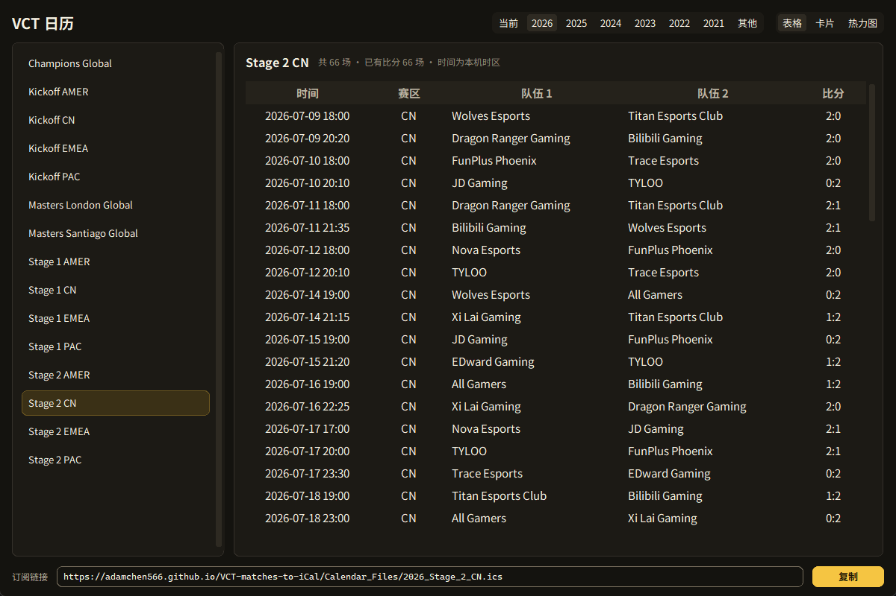
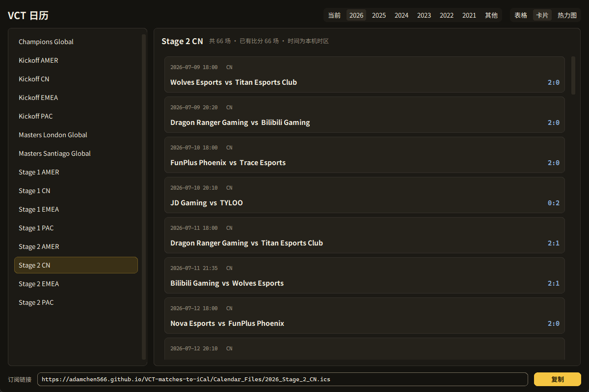
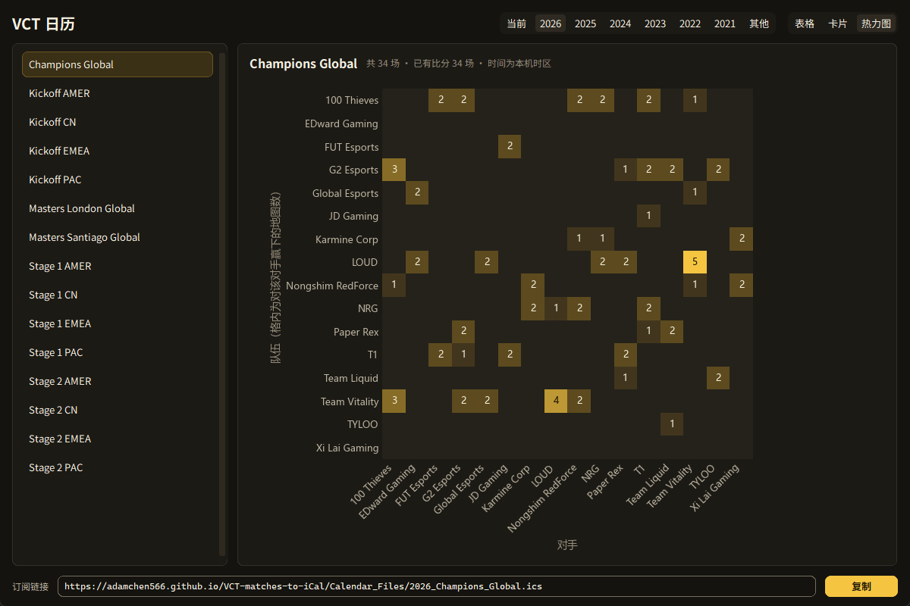

# VLR.gg Valorant 比赛日程工具

[English](README.md) | [简体中文](README.zh.md)

---

## 📖 项目概览

本项目是一个基于 Python 的 **Valorant（无畏契约）比赛数据爬虫与可视化工具**，从 [VLR.gg](https://www.vlr.gg) 抓取数据，支持 `.ics` 日历导出、图形界面多种视图展示，以及多年份多赛区的比赛信息追踪。

订阅日历跟踪哪些赛事由 [`events.toml`](events.toml) 决定，换赛事不需要改代码。当前配置为 **VCT 2027 Kickoff** 四大赛区（VLR 公布赛程后比赛会自动出现）：

- Americas（AMER）
- Pacific（PAC）
- EMEA
- China（CN）

GitHub Actions 每天 **澳洲悉尼时间 14:00** 自动抓取并更新日历；夏令时切换由时区规则自动处理。

---

## 🎯 功能特色

- **🎮 比赛信息抓取**：抓取比赛名称、时间、参赛队伍和比分。
- **📅 日历导出支持**：将比赛信息转换为 `.ics` 文件，支持日历同步。
- **🖥️ 多视图 GUI 显示**：
  - **表格视图**：结构化完整比赛列表。
  - **卡片视图**：按队伍呈现的紧凑视图。
  - **热力图视图**：使用 seaborn 绘制的队伍胜负矩阵。
- **📂 可滚动赛事列表**：快速浏览 2021–2026 年全部赛事。
- **📱 日历订阅功能**：可在系统日历中订阅 `.ics` 实时更新。
- **🔄 稳定增量更新**：每场比赛使用固定 UID，避免手机日历产生重复事件。

---

## 🖼 图形界面截图

| 表格视图 | 卡片视图 | 热力图视图 |
|---------|----------|------------|
|  |  |  |

使用方法：

```bash
python GUI.py
```

---

## 📅 日历订阅说明

想实时掌握比赛进展？请订阅以下自动更新的 `.ics` 文件：

- **当前赛事日历（VCT 2027 Kickoff 四赛区）**：

  https://raw.githubusercontent.com/Adamchen566/VCT-matches-to-iCal/main/vct_OnGoing.ics

### 订阅方式：

- **Google 日历**：设置 → 添加日历 → 来自 URL → 粘贴上述链接。
- **iOS/macOS 日历**：文件 → 新建日历订阅 → 粘贴链接。
- **小米/Android 系统日历**：安装支持网络 ICS 订阅的同步应用（例如 [ICSx⁵](https://icsx5.bitfire.at/)），添加上述 URL，设置自动同步，然后在系统日历里勾选该日历。请不要直接下载后“导入”，因为一次性导入不会自动更新。

---

## 🚀 快速开始

### 📋 环境要求

- Python 3.x
- 支持系统：Windows / macOS / Linux

### 📦 安装依赖

```bash
python -m pip install -r requirements.txt
```

### 🔧 安装方式

```bash
git clone https://github.com/Adamchen566/VCT-matches-to-iCal
cd VCT-matches-to-iCal
python update_calendar.py
python update_calendar.py --check
```

生成文件：

- `vct_OnGoing.ics`：手机/电脑日历订阅文件
- `vct_OnGoing.txt`：按澳洲悉尼时间显示的可读赛程
- `data/matches.json`：稳定更新所需的比赛缓存

### 🔁 切换赛事

编辑 `events.toml`，每个 `[[events]]` 对应 vlr.gg 上的一个赛事页（`https://www.vlr.gg/event/matches/<event_id>/<slug>/`）：

```toml
[calendar]
name = "VCT 2027 Kickoff - AMER PAC EMEA CN"
display_timezone = "Australia/Sydney"

[[events]]
region = "AMER"
event_id = 3178
slug = "vct-2027-americas-kickoff"
name = "VCT 2027: Americas Kickoff"
```

推送后 GitHub Actions 会自动重新生成日历，订阅链接保持不变。如果某个赛事抓到的场次比上次发布的少，脚本会拒绝覆盖现有日历；确认是 VLR 真的删了比赛时，用 `python update_calendar.py --allow-shrink`。

已结束的赛事归档在 `Calendar_Files/`（例如 `2026_Stage_2_All.ics`）。

---

## 📜 协议许可

本项目遵循 MIT 开源协议，详见 [LICENSE](LICENSE)。

---

## 💬 问题反馈与贡献

1. 发现 bug 或提出建议请提 Issue。
2. 欢迎 Fork 项目并提交 Pull Request！

感谢使用本工具！🎉
