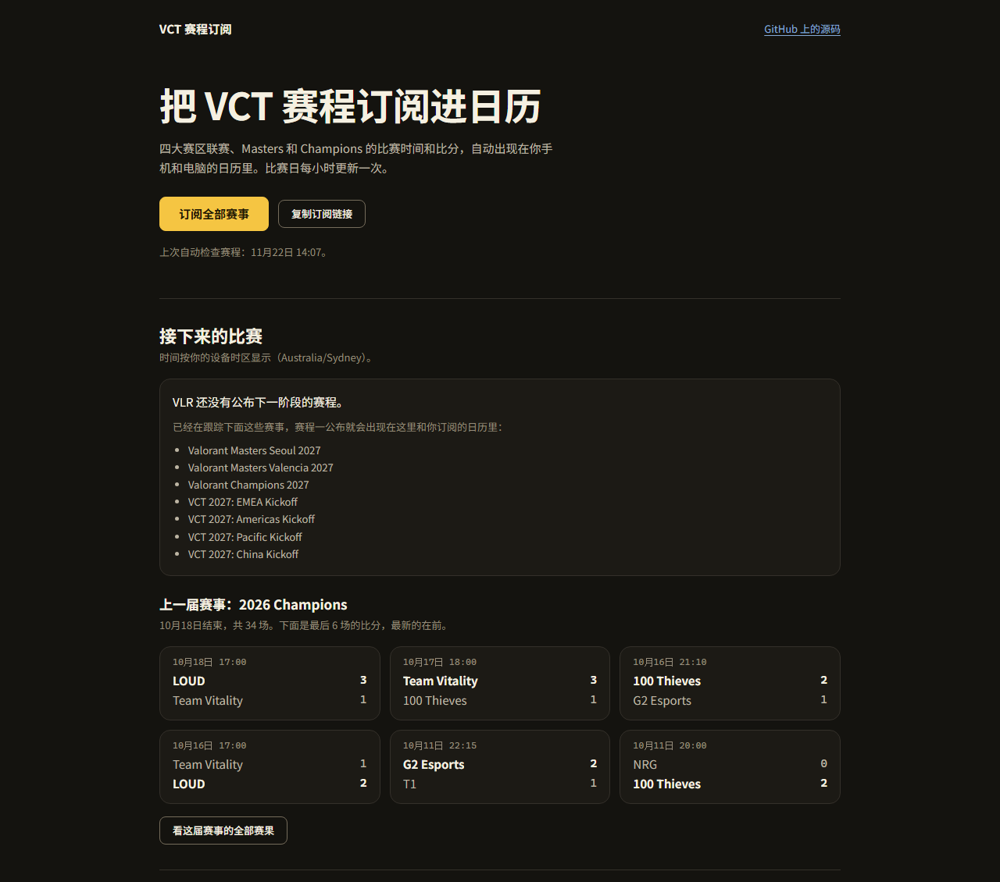
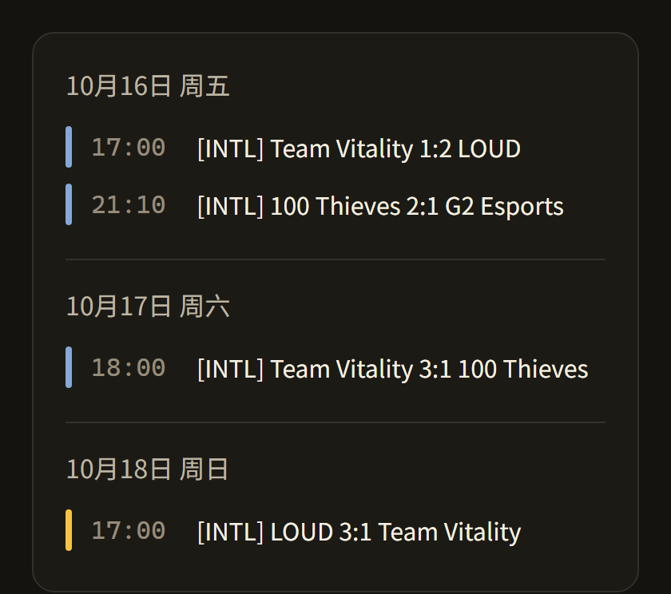
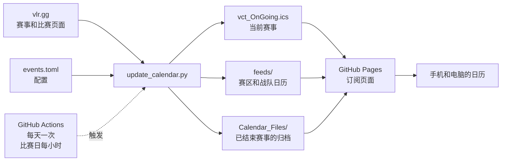

# VCT 赛程订阅

[English](README.md) | [简体中文](README.zh.md)

[](https://github.com/Adamchen566/VCT-matches-to-iCal/actions/workflows/update_OnGoing.yml)
[](https://github.com/Adamchen566/VCT-matches-to-iCal/actions/workflows/tests.yml)
[](requirements.txt)
[](LICENSE)

把 VCT（无畏契约冠军巡回赛）的比赛时间和比分订阅进手机和电脑的日历。数据来自 [vlr.gg](https://www.vlr.gg)，GitHub Actions 自动更新，不需要自己运行任何东西。

**[打开订阅页面](https://adamchen566.github.io/VCT-matches-to-iCal/)**

[](https://adamchen566.github.io/VCT-matches-to-iCal/)

## 怎么用

| 你想要 | 做法 |
|---|---|
| 全部赛事 | 在[订阅页面](https://adamchen566.github.io/VCT-matches-to-iCal/)点「订阅全部赛事」 |
| 只看一个赛区 | 订阅页面的「只看一个赛区」：AMER、PAC、EMEA、CN，国际赛是 INTL |
| 只看一支战队 | 订阅页面的「只看一支战队」，可以搜索 |
| 往年赛果 | 订阅页面的「赛季回顾」，或下载 [`Calendar_Files/`](Calendar_Files) 里的日历文件 |

要选「订阅」而不是「导入」，导入的日历不会自动更新。

| 设备 | 订阅方式 |
|---|---|
| iPhone、iPad、Mac | 直接点订阅页面上的「订阅」，或在日历的「添加订阅日历」里粘贴链接 |
| Google 日历 | 电脑版「其他日历」旁的加号 →「通过网址添加」→ 粘贴链接 |
| 小米和其他安卓手机 | 系统日历通常不支持网络订阅，装 [ICSx⁵](https://icsx5.bitfire.at/) 之类的同步应用，把链接加进去并打开自动同步 |

订阅链接也可以直接用：

- 全部赛事：`https://adamchen566.github.io/VCT-matches-to-iCal/vct_OnGoing.ics`
- 赛区：`https://adamchen566.github.io/VCT-matches-to-iCal/feeds/region/AMER.ics`（把 `AMER` 换成 `PAC`、`EMEA`、`CN` 或 `INTL`）
- 战队：`https://adamchen566.github.io/VCT-matches-to-iCal/feeds/team/paper-rex.ics`（战队名小写、空格换成连字符，完整列表见订阅页面）

## 日历里是什么样



上图是示意图，标题按日历文件里的实际内容绘制，具体样式取决于你用的日历应用。

- 赛前的标题是 `[CN] A vs B (Bo3)`，有比分后变成 `[CN] A 2:1 B`。
- 每场比赛有固定的 UID，改期和比分更新不会产生重复事件。
- 不想在标题里看到比分（避免剧透）的话，在 [`events.toml`](events.toml) 里设 `score_in_title = false`。

## 它是怎么工作的



| 环节 | 说明 |
|---|---|
| 自动发现 | 每次运行读取 vlr.gg 的赛事列表，自动跟踪进行中和即将开始的 VCT 一级赛事：四大赛区的 Kickoff、Stage 1、Stage 2，以及 Masters 和 Champions |
| 更新频率 | 每天一次；有比赛即将开始或正在进行时每小时一次，比分和改期一小时内同步 |
| 自动归档 | 赛事全部打完并且最后一场结束满 7 天后，从订阅日历移出，归档到 `Calendar_Files/`、`TEXT_Files/` 和 `data/archive/` |
| 防止坏数据 | 抓到的场次比上次发布的少时拒绝覆盖；每次运行先解析一个已结束赛事作为探针，区分「还没排赛程」和「页面改版」 |
| 故障告警 | 定时更新失败时自动开一个 Issue 并附日志，之后某次运行成功会自动关闭它 |

## 赛季回顾

订阅页面下方按年份画出每届赛事的时间轴，点一条横杠可以用表格、卡片或热力图看它的全部赛果。

[](https://adamchen566.github.io/VCT-matches-to-iCal/#season)

## 桌面图形界面

仓库里还有一个离线的桌面程序，读取同一批日历文件，同样有三种视图。

| 表格视图 | 卡片视图 | 热力图视图 |
|---------|----------|------------|
|  |  |  |

```bash
python -m pip install -r requirements-gui.txt
python GUI.py
```

图形界面只读取仓库内的 `vct_OnGoing.ics` 和 `Calendar_Files/`，不访问网络；底部的「复制」按钮会复制当前赛事对应的订阅链接。

## 自己运行

需要 Python 3.11 及以上，Windows、macOS、Linux 都可以。

```bash
git clone https://github.com/Adamchen566/VCT-matches-to-iCal
cd VCT-matches-to-iCal
python -m pip install -r requirements.txt
python update_calendar.py
python update_calendar.py --check
```

| 生成的文件 | 内容 |
|---|---|
| `vct_OnGoing.ics` | 当前赛事的订阅日历 |
| `vct_OnGoing.txt` | 按澳洲悉尼时间显示的可读赛程 |
| `data/matches.json` | 稳定更新所需的比赛缓存 |
| `feeds/` | 每个赛区、每支战队的日历，以及订阅页面读取的索引和赛果 |

| 想做的事 | 做法 |
|---|---|
| 添加预选赛或第三方赛事 | 自动发现只认一级赛事，其他赛事在 [`events.toml`](events.toml) 里用 `[[events]]` 添加 |
| 改保留天数或显示时区 | 同样在 `events.toml` 里 |
| 归档一个已经结束的赛事 | `python update_calendar.py --archive 2766/valorant-champions-2026` |
| VLR 真的删了比赛 | `python update_calendar.py --allow-shrink` |
| 跑测试 | `python -m unittest discover -s tests` |

订阅页面的分享预览图和日历示意图由 [`images/social-card.html`](images/social-card.html) 渲染得到，改完后用无头浏览器重新截图：

```bash
msedge --headless --hide-scrollbars --window-size=1200,630 --screenshot=images/social-card.png images/social-card.html
```

## 协议和反馈

本项目遵循 MIT 开源协议，详见 [LICENSE](LICENSE)。与 Riot Games 和 vlr.gg 没有关联。

发现问题或有建议请提 [Issue](https://github.com/Adamchen566/VCT-matches-to-iCal/issues)，也欢迎 Fork 后提交 Pull Request。
